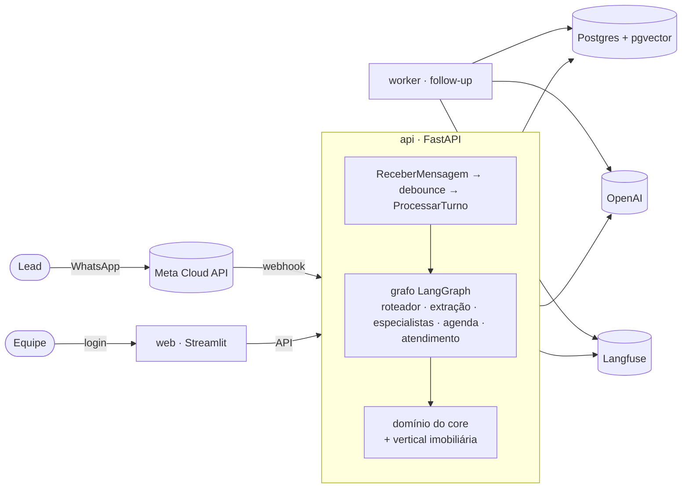

# Lia — Agente SDR com IA generativa (vertical imobiliária)

[](https://github.com/amaranini/tech-challenge-fase-5/actions/workflows/ci.yml)

Tech Challenge FIAP — Fase 5. A **Lia** é uma consultora virtual de imobiliária que atende
leads pelo **WhatsApp** (e por um chat web), entende o que a pessoa quer (comprar, alugar
ou investir), mostra **imóveis reais da base**, qualifica o lead, **agenda a visita** com o
corretor certo, passa o caso para uma pessoa quando preciso e faz **follow-up**, tudo com
dashboard, observabilidade, guardrails e avaliação.

- **No ar:** dashboard em https://web-production-a6acc.up.railway.app · API em
  https://api-production-e5c4.up.railway.app/health

### Acesso para avaliação

| | |
|---|---|
| Dashboard | https://web-production-a6acc.up.railway.app |
| Usuário | `avaliador` |
| Senha | `fiap-7377b451` |

O usuário de avaliação é **somente leitura**: vê todas as páginas (visão geral, leads com
conversa, ficha, score e resumo, fila, agenda, follow-ups, qualidade da IA), mas não
assume, não responde e não devolve atendimentos. Telefones, e-mails e CPFs aparecem
mascarados. Para conversar com a Lia, use **Demonstração → Chat com a Lia → ➕ Novo
lead**, ou rode o projeto localmente com o seu próprio usuário (abaixo).

## Sumário

[Problema e solução](#problema-e-solução) · [Funcionalidades × requisitos](#funcionalidades--requisitos) ·
[Diferenciais](#diferenciais) · [Arquitetura](#arquitetura-resumida) ·
[Como rodar](#como-rodar-local) · [Variáveis](#variáveis-de-ambiente) ·
[Como testar](#como-testar) · [Estrutura](#estrutura-de-pastas) ·
[Limitações](#limitações-conhecidas) · [Roadmap](#roadmap) · [Documentação](#documentação)

## Problema e solução

**Problema.** Imobiliárias recebem leads a qualquer hora pelo WhatsApp e perdem boa parte
deles: a resposta demora, a qualificação é manual e inconsistente, o corretor recebe o
lead sem contexto e ninguém faz o acompanhamento de quem parou de responder.

**Solução.** Um agente de pré-vendas (SDR) que:

1. responde na hora, em linguagem natural, e espera a pessoa terminar de digitar
   (mensagens picadas viram uma resposta só);
2. identifica a intenção e preenche uma **ficha de qualificação** campo a campo, sem
   formulário, com **score 0–100** e motivos;
3. busca imóveis com **RAG híbrido** (filtros + semântica) e só cita o que existe na base;
4. **agenda** visita ou reunião com o responsável certo, em horários reais, só depois do
   "sim" do lead;
5. passa para uma pessoa da equipe **com confirmação**, com um **resumo ancorado** do
   lead; a IA fica em silêncio enquanto a pessoa atende;
6. faz **follow-up** com cadência, respeita opt-out e a janela de 24 h do WhatsApp;
7. dá à operação um **dashboard** (funil, fila, agenda, follow-ups, qualidade da IA).

O projeto separa um **core de SDR genérico** de uma **vertical** (imobiliária): outro
segmento é um pacote novo, sem reescrever o núcleo.

## Funcionalidades × requisitos

| Requisito | Como foi atendido | Onde ver |
|---|---|---|
| Atender leads em linguagem natural, com persona | Lia, persona e prompts versionados; memória da conversa no banco; multicanal (WhatsApp + web) | chat do dashboard, WhatsApp |
| Entender a intenção (compra, aluguel, investimento) | roteador por LLM com saída estruturada; troca de intenção preserva a ficha anterior | [docs/ia.md §2](docs/ia.md#2-o-grafo-de-agentes) |
| Qualificar o lead | ficha incremental por intenção (JSONB), score com motivos, critério de qualificado e próxima ação | [qualificacao-imobiliaria.md](docs/qualificacao-imobiliaria.md) |
| Sugerir imóveis da base (sem inventar) | busca híbrida pgvector + filtros; códigos conferidos no catálogo antes de enviar | [ADR 002](docs/adr/002-busca-hibrida-embeddings-locais.md) |
| **Exemplo 1:** comprador → visita com corretor | qualificação → oferta de horários reais → confirmação → reserva → resumo ao corretor | roteiro 01 do eval |
| **Exemplo 2:** investidor → especialista | ficha de investimento → reunião online com a especialista | roteiro 02 do eval |
| **Exemplo 3:** lead some → follow-up | worker com cadência (D+1, D+3, D+7), item novo do catálogo, reengajamento, opt-out | roteiros 08 e 09 |
| Agendamento | `AgendaPort` (mock em Postgres), atribuição por região/intenção, remarcar e cancelar com confirmação | [ADR 007](docs/adr/007-agendamento-agenda-mock.md) |
| Passagem para humano | máquina de estados com confirmação, fila com SLA, equipe assume/responde/devolve | [ADR 009](docs/adr/009-atendimento-humano-handoff.md) |
| Canal WhatsApp | Meta Cloud API (ou Twilio): webhook assinado, idempotente, templates fora da janela de 24 h | [ADR 012](docs/adr/012-canal-whatsapp-templates.md) |
| Dashboard | Streamlit multipágina só via API: visão geral, leads, fila, agenda, follow-ups, qualidade da IA | [ADR 014](docs/adr/014-dashboard-consultas.md) |
| Observabilidade | Langfuse: 1 rastro por turno, etapa por nó, geração por chamada ao LLM, PII mascarada | [ADR 013](docs/adr/013-observabilidade-langfuse.md) |
| Segurança e guardrails | anti-injeção, escopo, validação de saída, rate limit, autenticação, PII, LGPD | [docs/seguranca.md](docs/seguranca.md) |
| Deploy e CI | Railway (api, worker, web, Postgres+pgvector), imagens multi-stage, GitHub Actions | [docs/deploy.md](docs/deploy.md) |
| Avaliação | 15 roteiros com LLM real, métricas objetivas, LLM-as-judge, custo e latência | [evals/relatorio.md](evals/relatorio.md) |

## Diferenciais

- **Core genérico × vertical**, ambos hexagonais, com as fronteiras **garantidas no build**
  (import-linter + teste de vocabulário): trocar infraestrutura é trocar adapter.
- **Turnos assíncronos com debounce:** a Lia responde ao conjunto de mensagens picadas, com
  advisory lock por lead e reprocessamento se chega mensagem nova antes do envio.
- **"O LLM interpreta, o código decide":** horários, merge da ficha, estados do
  atendimento e validação de saída são determinísticos e testados.
- **Resumo para o corretor ancorado:** dados do estado, imóveis só os citados, evidência
  literal das falas, verificador de frases; vai também para o CRM (mock).
- **Guardrails em camadas:** hierarquia de instruções, detector de injeção (heurística +
  LLM), resposta segura, PII fora dos logs e do LLM, LGPD (exportar/anonimizar).
- **Qualidade da IA no dashboard:** eval offline + métricas online por **versão do agente**
  (persona · modelo · prompts), onde o lead abandona, custo por agendamento, links para o
  Langfuse; feedback "útil / não útil" do corretor no resumo.
- **Avaliação que mudou o produto:** o eval encontrou um falso "não temos" na busca e
  respostas com duas perguntas; ambos corrigidos, com antes × depois no relatório.
- **Mais de 800 testes** (unitários, integração com Postgres real, roteiros com LLM real).

## Arquitetura resumida



Detalhes: C4 (contexto, containers, componentes), sequência completa de um turno,
máquina de estados do atendimento e índice dos 17 ADRs em
[docs/arquitetura.md](docs/arquitetura.md). A parte de IA (modelos por nó, grafo, RAG,
memória, guardrails, resultados) está em [docs/ia.md](docs/ia.md).

## Como rodar (local)

**Pré-requisitos:** Docker com Docker Compose, [uv](https://docs.astral.sh/uv/) (instala o
Python 3.12) e uma chave da OpenAI.

```bash
git clone https://github.com/amaranini/tech-challenge-fase-5 && cd tech-challenge-fase-5
cp .env.example .env
# no .env: OPENAI_API_KEY=sk-...   e, para o login do dashboard (só local):
#          DASHBOARD_USUARIO=equipe   DASHBOARD_SENHA=uma-senha
docker compose up -d --build --wait   # db, api, worker e web (1ª build baixa o modelo de embeddings)
make seed                             # 60 imóveis + embeddings + agenda mock (idempotente)
make seed-demo                        # opcional: ~40 leads sintéticos para o dashboard
```

| O quê | Onde |
|---|---|
| Dashboard (login) e chat com a Lia | http://localhost:8501 → *Demonstração → Chat com a Lia* |
| API + documentação interativa | http://localhost:8000/docs |
| Saúde | http://localhost:8000/health |
| Postgres + pgvector | `localhost:5433` (usuário, senha e banco: `sdr`) |

Com `ADMIN_API_KEYS` vazio e `AMBIENTE=local`, as rotas da equipe ficam abertas (aviso no
log). Para testar a proteção, gere uma chave (`openssl rand -hex 32`), coloque em
`ADMIN_API_KEYS` e recrie os serviços: o dashboard passa a usá-la sozinho.

**Primeira conversa pela API** (o mesmo que o chat faz):

```bash
curl -s localhost:8000/conversas/mensagens -H 'content-type: application/json' \
  -d '{"lead_id": "lead-ana", "texto": "Oi! Quero comprar um apê de 2 quartos na zona sul até 800 mil"}'
# → 202: a Lia espera você parar de digitar (5 s) e responde ao conjunto
curl -s localhost:8000/conversas/lead-ana/mensagens | python3 -m json.tool   # histórico
curl -s localhost:8000/leads/lead-ana | python3 -m json.tool                 # ficha, score, eventos
make busca q="apê 2 quartos zona sul até 800 mil perto do metrô"            # busca híbrida
```

**WhatsApp (opcional).** Precisa de uma URL pública (túnel ou o deploy) e de um app na
Meta (Cloud API) ou conta Twilio. Veja o [passo a passo](#whatsapp-passo-a-passo) abaixo.

**Langfuse (opcional).** Com `LANGFUSE_PUBLIC_KEY`, `LANGFUSE_SECRET_KEY` e
`LANGFUSE_BASE_URL` no `.env`, cada resposta ganha o link **🔎 trace**. Sem as chaves,
nada é enviado.

**Na nuvem:** [docs/deploy.md](docs/deploy.md) (Railway, `.railway/railway.ts`).

## Variáveis de ambiente

Todas comentadas em [.env.example](.env.example). As principais:

| Variável | Para quê | Padrão |
|---|---|---|
| `OPENAI_API_KEY` | LLM (obrigatória) | — |
| `LLM_MODELO`, `LLM_MODEL_ROUTER/EXTRACTION/AGENT/SUMMARY` | modelo padrão e por nó do grafo | `gpt-4.1-mini` |
| `AMBIENTE` | `local` ou `producao` (produção: sem `/demo` e `/docs`; exige credenciais) | `local` |
| `ADMIN_API_KEYS` | chave(s) do header `X-API-Key` das rotas da equipe | vazio |
| `DASHBOARD_USUARIO`, `DASHBOARD_SENHA_HASH` (ou `DASHBOARD_SENHA`, só local) | login do dashboard (`uv run python -m sdr.cli hash-senha`) | vazio |
| `DEBOUNCE_SEGUNDOS`, `DEBOUNCE_MAX_SEGUNDOS` | espera pelo fim da digitação | 5 / 20 |
| `WHATSAPP_PROVEDOR`, `META_*` ou `TWILIO_*`, `PUBLIC_BASE_URL` | canal WhatsApp | desligado |
| `WHATSAPP_TEMPLATES` | nome lógico → template aprovado (fora da janela de 24 h) | `{}` |
| `FOLLOWUP_UNIDADE` | cadência em `dias` (produção) ou `minutos` (demo) | `dias` |
| `ATENDIMENTO_DIAS`, `ATENDIMENTO_FAIXAS`, `HANDOFF_SLA_MINUTOS` | horário da equipe e SLA da fila | seg–sex, 9h–18h, 15 min |
| `LANGFUSE_PUBLIC_KEY`, `LANGFUSE_SECRET_KEY`, `LANGFUSE_BASE_URL` | observabilidade | desligado |
| `MENSAGEM_MAX_CARACTERES`, `LIMITE_*_POR_MINUTO`, `CONFIAR_PROXY` | limites e rate limit | 2000 / 20 / 60 |
| `CUSTO_LLM_POR_MILHAO` | preço por modelo para as métricas de custo | tabela padrão |
| `VERTICAL` | vertical ativa | `imobiliario` |

## Como testar

```bash
uv sync
make check     # ruff (lint + formato) + mypy strict + import-linter + pytest (unit + integração)
```

- **Integração** (`tests/integration/`): usa o Postgres do compose num banco separado
  (`sdr_test`, recriado e migrado a cada sessão); é pulada se o banco não estiver no ar.
- **Com o LLM real** (custam tokens; precisam da API no ar, fora do `make check`):
  - `make e2e`: memória, retomada e nenhum imóvel inventado;
  - `make llm`: os 15 roteiros de `evals/cenarios/`, com asserts no estado do lead.
- **Avaliação completa:** `make eval` (~15 min) gera [evals/relatorio.md](evals/relatorio.md)
  com intenção, extração, comportamentos, ancoragem, juiz, latência e custo, e registra a
  rodada no dashboard. `make eval args="-k injecao --sem-juiz"` roda um subconjunto.
  Detalhes em [evals/README.md](evals/README.md).
- **CI:** GitHub Actions a cada push (ruff, mypy, import-linter, `alembic check`, pytest).

## Estrutura de pastas

```
src/sdr/
  core/                 SDR genérico — não conhece imóvel (teste garante)
    domain/             regras puras: qualificação, agenda, atendimento, follow-up, resumo,
                        templates, segurança, PII
    application/        casos de uso, ports (Protocols), consultas do dashboard
    adapters/           FastAPI e webhooks · Postgres · LangGraph · OpenAI · canais · Langfuse
    vertical.py         contrato VerticalPack
  verticals/imobiliario/  catálogo + busca, persona Lia, fichas e scoring, agenda,
                        follow-up, template do resumo, dados (60 imóveis, 4 responsáveis)
  bootstrap.py          composition root · main.py (API) · worker.py · cli.py
web/                    dashboard Streamlit (só via API) + login
evals/                  roteiros, runner, métricas, juiz, relatório
tests/                  unit · integration · e2e · llm
migrations/             Alembic (histórico único core + verticais)
docker/                 Dockerfiles multi-stage (api/worker e web)
.railway/railway.ts     infraestrutura da Railway como código
docs/                   arquitetura, IA, segurança, deploy, roadmap, ADRs
```

## Limitações conhecidas

- **API com 1 réplica:** o debounce dos turnos e o rate limit são em memória; escalar
  exige fila/Redis (só adapters; ver roadmap).
- **Agenda e CRM são mocks** em Postgres (`AgendaPort`, `CRMPort` prontos para Google
  Calendar e HubSpot).
- **WhatsApp:** número da conta de demonstração; templates **não aprovados**, então fora da
  janela de 24 h a Lia não envia mensagem ativa (registra `EnvioTemplateIndisponivel`).
- **Deploy contínuo:** depende do app GitHub da Railway com acesso ao repositório; até
  lá, os deploys são disparados pela CLI ([docs/deploy.md](docs/deploy.md)).
- **Segurança de POC:** chave de admin única e login compartilhado (sem SSO), chat web sem
  sessão assinada, detecção de injeção por heurística + LLM (pode falhar com ataques
  novos). Riscos residuais em [docs/seguranca.md](docs/seguranca.md).
- **Avaliação:** uma execução por roteiro, roteiros fáceis para intenção/extração, juiz
  LLM sem calibração humana ([análise](evals/relatorio.md#análise)).
- A Lia **só entende texto** (áudio e imagem são registrados e respondidos com aviso).

## Roadmap

Resumo de [docs/roadmap-producao.md](docs/roadmap-producao.md):

1. **Adapters de produção:** número e templates aprovados na Meta, Google Calendar/Outlook,
   HubSpot, Redis/fila para turnos, rate limit e eventos (outbox).
2. **Escala horizontal** da API (stateless depois do item 1), réplica de leitura,
   backups/PITR.
3. **Multi-tenant** (várias imobiliárias) e **segunda vertical** (novo `VerticalPack`, sem
   mudar o core).
4. **Qualidade contínua:** LLM-as-judge por amostragem nas conversas reais (no worker, PII
   mascarada, notas baixas para revisão humana) e correções do corretor virando cenários
   do eval.
5. **Segurança:** SSO e papéis, sessões assinadas no chat, retenção e exclusão no Langfuse.

## Documentação

| Documento | Conteúdo |
|---|---|
| [docs/arquitetura.md](docs/arquitetura.md) | C4, sequência de um turno, estados do atendimento, core × vertical, índice de ADRs |
| [docs/ia.md](docs/ia.md) | modelos por nó, grafo de agentes, RAG, ficha incremental, memória, debounce, guardrails, resultados e custo |
| [docs/seguranca.md](docs/seguranca.md) | ameaças, controles, onde vivem, riscos residuais |
| [docs/deploy.md](docs/deploy.md) | Railway passo a passo, variáveis, webhook, CI |
| [docs/roadmap-producao.md](docs/roadmap-producao.md) | o que muda para produção |
| [docs/qualificacao-imobiliaria.md](docs/qualificacao-imobiliaria.md) | regras de negócio da qualificação |
| [docs/whatsapp-templates.md](docs/whatsapp-templates.md) | textos dos templates para aprovação na Meta |
| [docs/adr/](docs/adr/) | 17 decisões de arquitetura |
| [evals/](evals/README.md) | avaliação: roteiros, métricas, rubrica do juiz, relatório |

## WhatsApp: passo a passo

A Lia atende pelo WhatsApp com as mesmas regras, o mesmo turno assíncrono e a mesma Fila.
O provedor é escolhido em `WHATSAPP_PROVEDOR`: `meta` (Cloud API oficial, recomendado) ou
`twilio`.

**URL pública.** Na nuvem, use o domínio da API. Localmente, use um túnel, de
preferência o ngrok com o domínio fixo gratuito, para a URL não mudar:

```bash
ngrok config add-authtoken <authtoken>
ngrok http --url=<seu-dominio>.ngrok-free.dev 8000
```

### Meta (WhatsApp Cloud API)

1. Em [developers.facebook.com](https://developers.facebook.com): *Meus apps → Criar app*
   com o caso de uso **WhatsApp**. Copie a **Chave secreta do app** (*Configurações do
   app → Básico*).
2. **Número:** o número de teste (+1 555…) não entrega para celular brasileiro em conta
   nova (erro 130497). Adicione um **número brasileiro** à conta do WhatsApp Business e
   anote o **Phone number ID**.
3. **Token permanente** (o temporário vence em 24 h): em *business.facebook.com →
   Usuários do sistema*, crie um admin, atribua o app e a conta do WhatsApp e gere um
   token sem expiração (`whatsapp_business_messaging`, `whatsapp_business_management`,
   `business_management`).
4. `.env`: `WHATSAPP_PROVEDOR=meta`, `META_ACCESS_TOKEN`, `META_PHONE_NUMBER_ID`,
   `META_APP_SECRET`, `META_VERIFY_TOKEN` (texto à sua escolha) e
   `FOLLOWUP_UNIDADE=minutos` para a demo.
5. **Webhook** (*WhatsApp → Configuração*): URL `https://<url-publica>/webhooks/whatsapp/meta`,
   o mesmo `META_VERIFY_TOKEN`, campo **messages**.
6. **Inscreva o app na conta** (sem isso só o botão "Testar" chega):
   `curl -X POST "https://graph.facebook.com/v22.0/<WABA_ID>/subscribed_apps" -H "Authorization: Bearer $META_ACCESS_TOKEN"`.
7. Mande "oi" do celular: o lead aparece como `📱 whatsapp:+55...` no dashboard.

### Twilio

1. Ative o **WhatsApp Sandbox** e mande do celular o `join <código>`. A conta trial só
   envia por Content Template (erro 21654); texto livre exige upgrade.
2. `.env`: `WHATSAPP_PROVEDOR=twilio`, `PUBLIC_BASE_URL=https://<url-publica>`,
   `TWILIO_ACCOUNT_SID`, `TWILIO_AUTH_TOKEN`, `TWILIO_WHATSAPP_FROM`.
3. *Sandbox settings* → "When a message comes in" =
   `https://<url-publica>/webhooks/whatsapp/twilio` (POST).

Os templates para aprovação estão em [docs/whatsapp-templates.md](docs/whatsapp-templates.md)
(gerados por `uv run python -m sdr.cli templates-doc`). Telefones aparecem mascarados nos
logs.
