# Arquitetura — Agente SDR Conversacional (vertical imobiliária)

Como o sistema é organizado e por quê. Para rodar, comece pelo [README](../README.md);
para a parte de IA (modelos, grafo, RAG, guardrails, avaliação), veja [docs/ia.md](ia.md).

**Em uma frase:** um **core de SDR genérico** (lead, conversa, qualificação, agenda,
atendimento humano, follow-up, canais, guardrails) e uma **vertical** que ensina o
negócio (imóveis, intenções compra/aluguel/investimento, persona "Lia"). As duas são
hexagonais: o domínio não conhece framework, banco nem LLM, e trocar infraestrutura é
trocar adapter.

## Sumário

1. [C4 — Contexto](#1-c4--contexto)
2. [C4 — Containers](#2-c4--containers)
3. [C4 — Componentes da API](#3-c4--componentes-da-api)
4. [Core genérico × vertical](#4-core-genérico--vertical)
5. [Um turno de ponta a ponta (do webhook ao envio)](#5-um-turno-de-ponta-a-ponta-do-webhook-ao-envio)
6. [Grafo de agentes (dentro do turno)](#6-grafo-de-agentes-dentro-do-turno)
7. [Máquina de estados do atendimento (IA × humano)](#7-máquina-de-estados-do-atendimento-ia--humano)
8. [Agenda, resumo e follow-up](#8-agenda-resumo-e-follow-up)
9. [Busca híbrida (RAG) e estado de qualificação](#9-busca-híbrida-rag-e-estado-de-qualificação)
10. [Segurança em camadas](#10-segurança-em-camadas)
11. [Implantação: local e nuvem](#11-implantação-local-e-nuvem)
12. [Índice dos ADRs](#12-índice-dos-adrs)

## 1. C4 — Contexto

Quem usa o sistema e com quais sistemas externos ele fala.

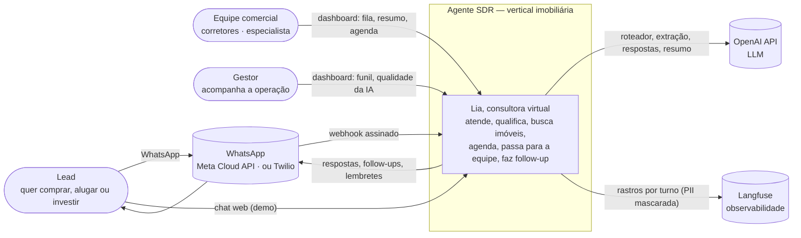

Agenda e CRM são **mocks em Postgres** atrás de ports (`AgendaPort`, `CRMPort`): a troca
por Google Calendar/Outlook e HubSpot é só de adapter ([roadmap](roadmap-producao.md)).

## 2. C4 — Containers

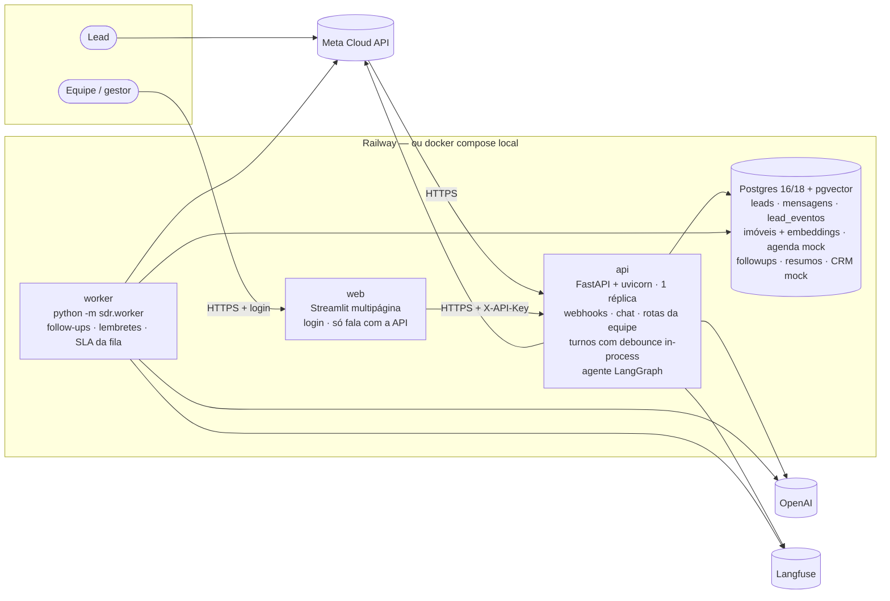

| Container | Imagem | Por que separado |
|---|---|---|
| `api` | `docker/api.Dockerfile` (modelo de embeddings embutido) | recebe tudo e roda o turno; **1 réplica** porque o debounce e o rate limit vivem em memória (ADR 006, ADR 015) |
| `worker` | a mesma imagem, outro comando | mensagens ativas não dependem de requisição; seguro para N réplicas (fila com `SKIP LOCKED`) |
| `web` | `docker/web.Dockerfile` (só Streamlit + httpx) | front fino, sem acesso ao banco nem às chaves do LLM/WhatsApp |
| `db` | `pgvector/pgvector` | dados relacionais, JSONB das fichas e índice vetorial no mesmo lugar |

## 3. C4 — Componentes da API

O core é um hexágono: `adapters → application → domain`. A vertical é montada por um
`VerticalPack` e entrega catálogo, persona, intenções, regras e rotas.

```mermaid
flowchart TB
    subgraph inbound[core · adapters/inbound/http]
        rotas[FastAPI<br/>/health · /conversas · /leads · /painel · /qualidade<br/>/atendimentos · /agendamentos · /lgpd · /demo]
        webhooks[webhooks WhatsApp<br/>Meta: X-Hub-Signature-256 · Twilio: X-Twilio-Signature<br/>idempotência pelo id do provedor]
        protecao[protecao.py<br/>X-API-Key · rate limit · IP]
    end

    subgraph application[core · application — sem frameworks]
        uc[casos de uso<br/>ReceberMensagem · ProcessarTurno · EntregarMensagem<br/>ConduzirAgendamento · GerarResumoHandoff · atendimento<br/>ProgramarFollowUps · ExecutarFollowUps · LGPD · AvaliarResumo]
        consultas["consultas (read models)<br/>painel · qualidade"]
        ports{{ports<br/>LLMPort · AgenteConversacionalPort · CatalogoPort · EmbeddingPort<br/>Lead/Conversa/LeadEvento repos · AgendaPort · CRMPort · CanalMensagemPort<br/>AgendadorTurnoPort · TravaTurnoPort · LimitadorTaxaPort · RastreioPort · DadosTitularPort}}
    end

    domain["core · domain — puro<br/>Lead · Conversa · Mensagem · Qualificacao · Score · EventoLead<br/>agenda (decidir) · atendimento (estados) · followup · resumo (ancoragem)<br/>template · seguranca (injeção, promessas) · pii"]

    subgraph outbound[core · adapters/outbound]
        agente["agent — AgenteQualificador (LangGraph)<br/>roteador · extração · especialistas · agenda · atendimento · redirecionar"]
        llm[llm — OpenAI · LLMObservado]
        persist[persistence — SQLAlchemy async<br/>repos · agenda mock · CRM mock · consultas SQL · LGPD]
        canais[canais — web · WhatsApp Meta · Twilio]
        outros["turnos (debounce) · trava (advisory lock) · eventos · limite_taxa<br/>embeddings (fastembed) · observabilidade (Langfuse)"]
    end

    subgraph vertical[verticals/imobiliario — PackImobiliario]
        catalogo[catalogo — Imovel · busca híbrida · rota /imoveis]
        persona[persona — Lia, prompts versionados, promessas do segmento]
        qualif[qualificacao — fichas por intenção · scoring · critério]
        agenda_v[agenda — atribuição por região/intenção · tipos de visita]
        followup_v[followup — cadências · templates]
        resumo_v[resumo — template do resumo para o corretor]
    end

    rotas & webhooks --> protecao
    rotas & webhooks --> uc
    rotas --> consultas
    uc --> ports
    uc --> domain
    consultas --> ports
    agente & llm & persist & canais & outros -. implementam .-> ports
    catalogo -. "CatalogoImobiliario implementa CatalogoPort" .-> ports
    vertical -. "entrega ao core via VerticalPack" .-> uc
```

**Regras que o build garante** (import-linter, `.importlinter`; violação quebra o CI):

| Contrato | O que impede |
|---|---|
| Camadas globais | `(main · cli · worker) > bootstrap > (verticals · config) > core` invertido |
| Core não importa verticals | qualquer `sdr.verticals` dentro de `sdr.core` |
| Hexágono do core | `domain` importar `application`; `application` importar `adapters` |
| Vertical imobiliária | `pack > followup > agenda > (config · catalogo · persona · qualificacao · resumo)` invertido |
| Hexágono das fatias | o mesmo do core dentro de `catalogo`, `qualificacao`, `agenda` |
| Núcleos puros | domain/application importarem FastAPI, Pydantic, SQLAlchemy, LangGraph, OpenAI, httpx, Streamlit, pgvector… |
| Adapters independentes | `core.adapters.inbound` ⟂ `core.adapters.outbound` |
| Web isolado | o Streamlit importar o backend ou o banco |

Além disso, `tests/unit/core/test_core_agnostico.py` garante o vocabulário: nenhum
"imóvel", "corretor" ou "metrô" dentro de `core/`.

## 4. Core genérico × vertical

O **core** sabe fazer SDR conversacional para qualquer segmento. A **vertical** ensina o
negócio. As duas se encontram no contrato `VerticalPack` ([ADR 003](adr/003-core-multi-segmento.md)).

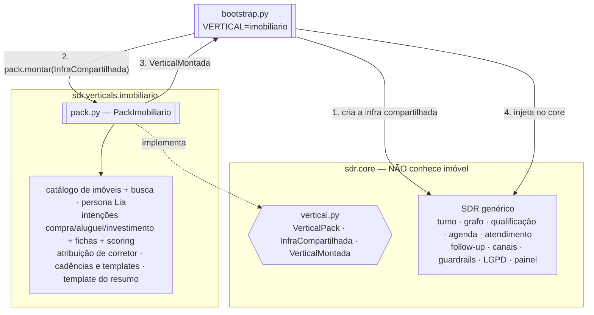

| O core decide | A vertical declara |
|---|---|
| quando trocar de intenção, como fazer merge da ficha, o que falta perguntar | quais intenções existem, o schema de cada ficha e a prioridade dos campos |
| que só confirma agenda depois do "sim", que horários são reais | quem atende cada lead (região, intenção) e os tipos de compromisso |
| quando o follow-up é elegível, janela de 24 h, SLA | a cadência (D+1, D+3, D+7) e o texto de cada template |
| ancoragem do resumo (nada sem lastro) | as seções do resumo para o corretor |
| guardrails genéricos (injeção, desconto, garantia) | promessas típicas do segmento e a resposta segura da persona |

Segunda vertical = um pacote novo em `verticals/` implementando o mesmo `VerticalPack`,
sem tocar no core.

## 5. Um turno de ponta a ponta (do webhook ao envio)

O lead manda três mensagens seguidas no WhatsApp. O webhook responde 200 na hora; a Lia
espera ele parar de digitar (debounce), responde **uma vez** ao conjunto e a resposta sai
pela Graph API ([ADR 006](adr/006-processamento-assincrono-debounce.md),
[ADR 012](adr/012-canal-whatsapp-templates.md)).

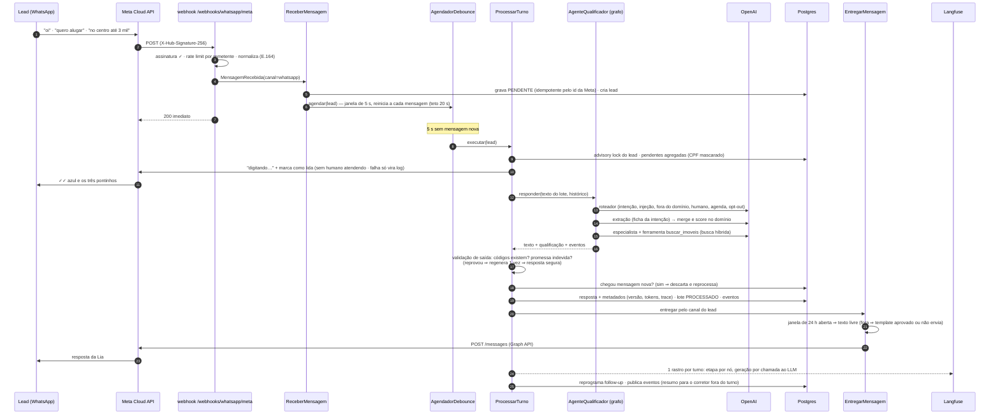

No chat web o caminho é o mesmo a partir de `ReceberMensagem` (POST 202 + polling).
Em `ATENDIMENTO_HUMANO` o grafo nem chama o LLM: a mensagem é só registrada para a equipe.

## 6. Grafo de agentes (dentro do turno)

Cada nó tem o seu LLM (modelo configurável por nó); as **regras** ficam no domínio e na
vertical, os nós só orquestram ([ADR 005](adr/005-grafo-qualificacao-multiagente.md)).

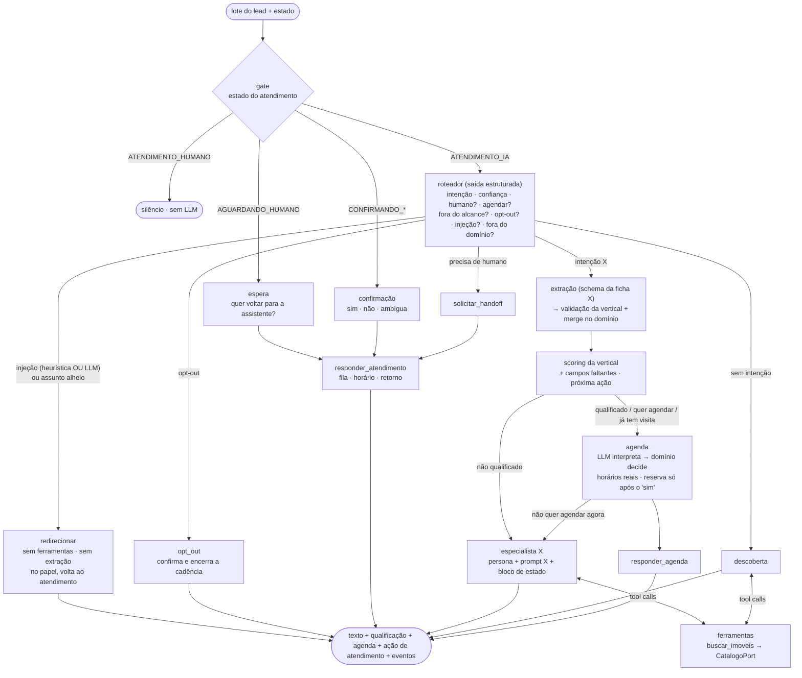

Toda resposta carrega a **hierarquia de instruções** (`seguranca_v1`: só o sistema
instrui; lead e ferramentas são dados) e os **limites** (`limites_v1`: o que a IA faz e o
próximo passo real para o resto).

## 7. Máquina de estados do atendimento (IA × humano)

Transição fora da tabela é erro de domínio; toda passagem pede confirmação explícita, e
uma resposta ambígua gera UMA nova pergunta ([ADR 009](adr/009-atendimento-humano-handoff.md)).

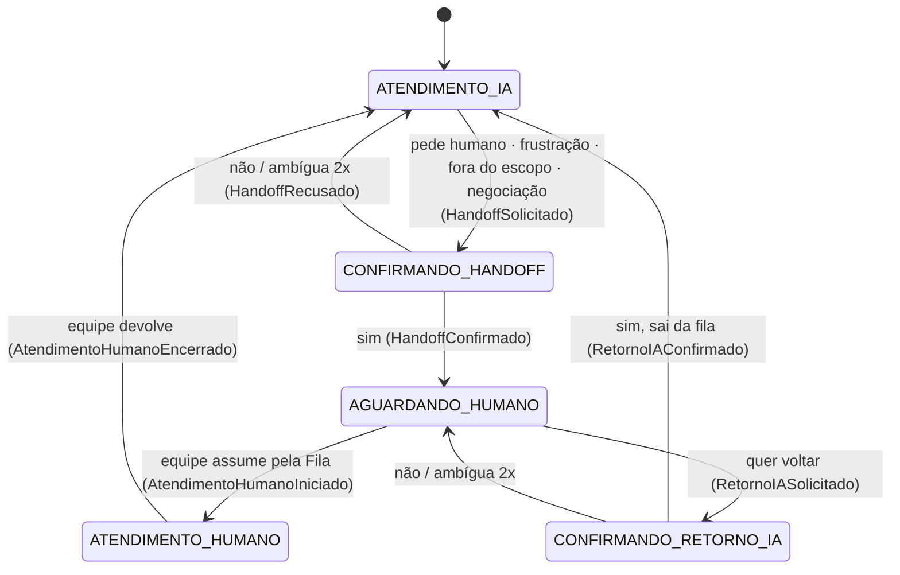

O grafo só **decide** a ação e prevê o novo estado. O `ProcessarTurno` recheca o estado
antes de enviar (se um humano assumiu no meio, a resposta é descartada) e aplica a ação
com compare-and-set. Fora do horário de atendimento da operação, a Lia avisa quando a
equipe volta; espera na fila acima do SLA (tempo útil) vira `HandoffSLAExcedido`.

## 8. Agenda, resumo e follow-up

### Negociação de horário ([ADR 007](adr/007-agendamento-agenda-mock.md))

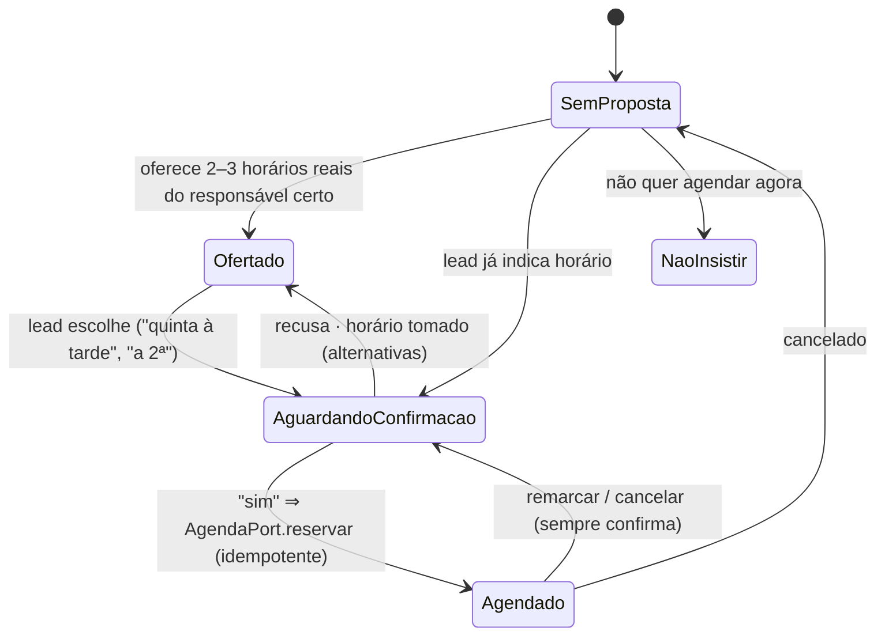

### Resumo para o responsável — fora do turno ([ADR 008](adr/008-resumo-handoff-crm.md))

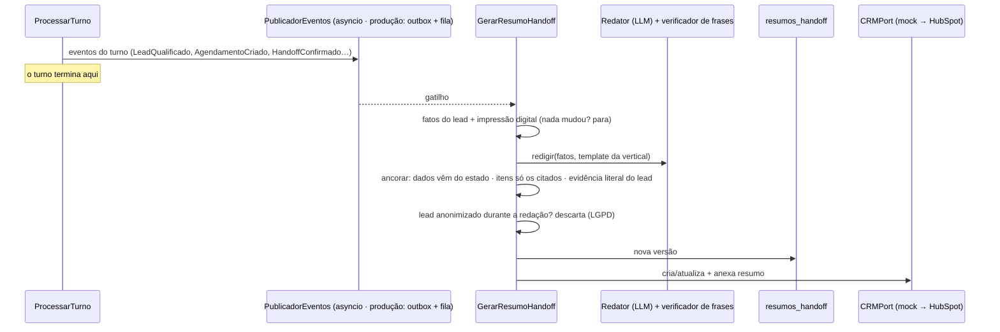

### Follow-up automático ([ADR 011](adr/011-followup-worker.md))

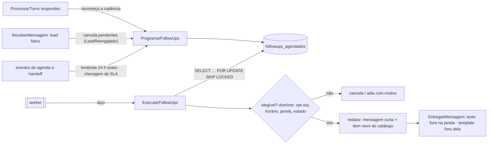

## 9. Busca híbrida (RAG) e estado de qualificação

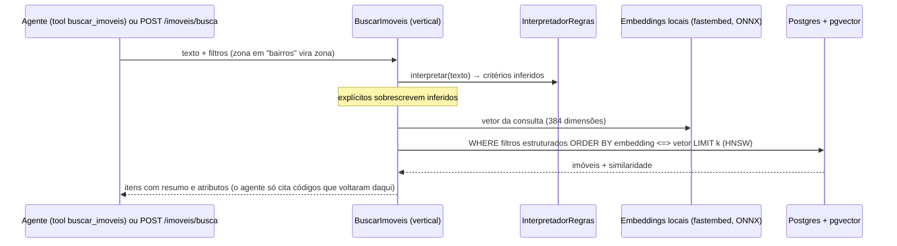

O estado do lead (`GET /leads/{id}`) vem do agregado `Qualificacao`: intenção atual,
uma ficha **JSONB por intenção** (trocar de intenção não apaga nada), campos faltantes
na prioridade da vertical, score com motivos, próxima ação e a trilha completa de
`lead_eventos`, que alimenta o painel, o funil e a página de Qualidade
([ADR 014](adr/014-dashboard-consultas.md), [ADR 017](adr/017-qualidade-da-ia.md)).

## 10. Segurança em camadas

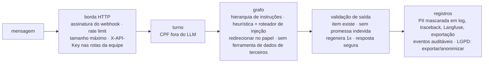

Ameaças, controles e riscos residuais: [docs/seguranca.md](seguranca.md) ([ADR 015](adr/015-seguranca-guardrails.md)).

## 11. Implantação: local e nuvem

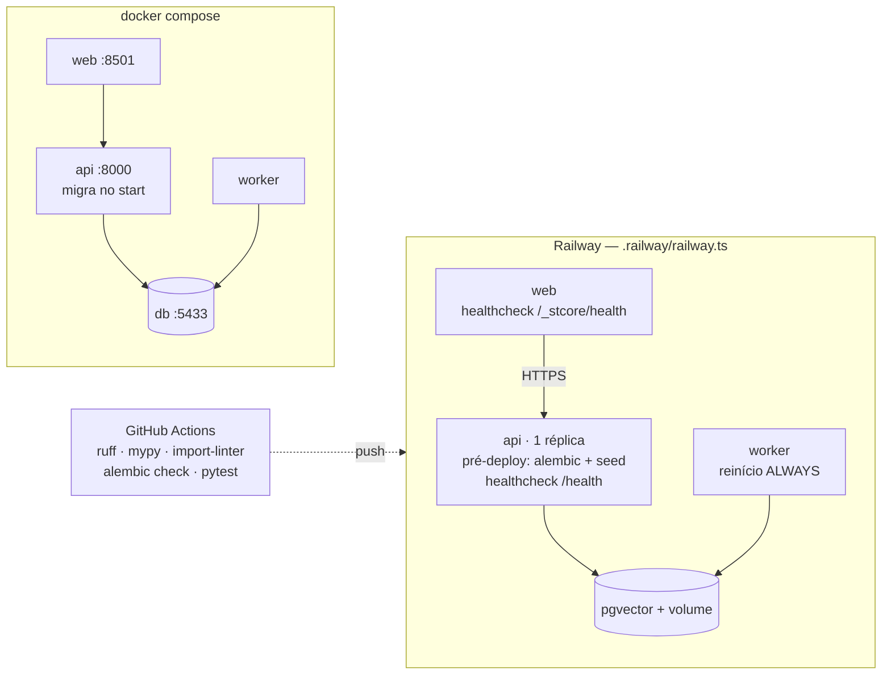

Passo a passo e variáveis em [docs/deploy.md](deploy.md) ([ADR 016](adr/016-deploy-railway.md)).

## 12. Índice dos ADRs

| ADR | Decisão |
|---|---|
| [001](adr/001-arquitetura-hexagonal.md) | Arquitetura hexagonal (Ports & Adapters) |
| [002](adr/002-busca-hibrida-embeddings-locais.md) | Busca híbrida: filtros estruturados + embeddings locais (fastembed) em pgvector |
| [003](adr/003-core-multi-segmento.md) | Core de SDR genérico × verticais (`VerticalPack`) |
| [004](adr/004-agente-llm-memoria.md) | LLM só por port, LangGraph como orquestrador, memória no banco |
| [005](adr/005-grafo-qualificacao-multiagente.md) | Grafo de qualificação: roteador, extração, scoring, especialistas |
| [006](adr/006-processamento-assincrono-debounce.md) | Turnos assíncronos com debounce e advisory lock |
| [007](adr/007-agendamento-agenda-mock.md) | Agendamento: domínio decide, confirmação antes de reservar, agenda mock |
| [008](adr/008-resumo-handoff-crm.md) | Resumo para o responsável fora do turno, ancorado; CRMPort |
| [009](adr/009-atendimento-humano-handoff.md) | Atendimento humano: máquina de estados, gate, compare-and-set |
| [010](adr/010-limites-do-assistente.md) | Limites do assistente: honestidade + próximo passo real |
| [011](adr/011-followup-worker.md) | Follow-up: fila SKIP LOCKED, worker, cadência da vertical |
| [012](adr/012-canal-whatsapp-templates.md) | Canal WhatsApp e templates (janela de 24 h) |
| [013](adr/013-observabilidade-langfuse.md) | Observabilidade com Langfuse (rastro por turno) |
| [014](adr/014-dashboard-consultas.md) | Dashboard: consultas separadas dos comandos, front só via API |
| [015](adr/015-seguranca-guardrails.md) | Segurança e guardrails em camadas |
| [016](adr/016-deploy-railway.md) | Deploy na Railway, imagens multi-stage, CI |
| [017](adr/017-qualidade-da-ia.md) | Qualidade da IA: métricas online por versão + eval offline na API |
