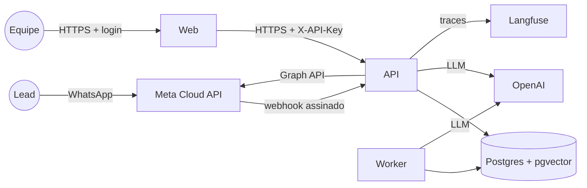

# Deploy na nuvem (Railway) e CI

Decisão: [ADR 016](adr/016-deploy-railway.md). Quatro serviços no mesmo projeto Railway,
todos a partir deste repositório:



| Serviço | Imagem | Domínio público | Healthcheck |
|---|---|---|---|---|
| `pgvector` | `pgvector/pgvector:pg18` (template da Railway, volume 5 GB) | não | da plataforma |
| `api` | `docker/api.Dockerfile` | sim (webhook e chat) | `/health` (consulta o banco) |
| `worker` | `docker/api.Dockerfile` (mesma) | não | reinício `ALWAYS` |
| `web` | `docker/web.Dockerfile` | sim (dashboard) | `/_stcore/health` |

Tudo isso está declarado em **`.railway/railway.ts`** (Infrastructure as Code da Railway;
o antigo config-as-code `railway.json` foi descontinuado). O que cada serviço faz:
- **api:** pré-deploy `alembic upgrade head && python -m sdr.cli seed` (migrations e
  seed idempotente do catálogo + agenda mock, num container separado, ANTES do novo
  deploy entrar), start só do uvicorn, healthcheck `/health`. **1 réplica** (veja
  Limitações).
- **worker:** `python -m sdr.worker` (laço do follow-up; seguro para várias réplicas).
- **web:** Streamlit na porta da plataforma, healthcheck do Streamlit.

As imagens são multi-stage: o modelo de embeddings é baixado no BUILD (a imagem final tem
`/models` e `HF_HUB_OFFLINE=1`, sem download no runtime), sem uv nem cache, usuário não
root. Tamanhos: api ≈ 770 MB (240 MB são o modelo), web ≈ 570 MB.

## Ambiente publicado

| | URL |
|---|---|
| API | https://api-production-e5c4.up.railway.app (`/health`) |
| Dashboard | https://web-production-a6acc.up.railway.app (login) |
| Webhook WhatsApp (Meta) | https://api-production-e5c4.up.railway.app/webhooks/whatsapp/meta |

Projeto Railway `sdr-lia` (workspace da PO), ambiente `production`, região US East.

## Passo a passo (do zero)

### 1. Pré-requisitos
- Conta na [Railway](https://railway.com) com o GitHub conectado e a CLI
  (`brew install railway && railway login`).
- Node/npm só para a ferramenta de infra: `npm install` na raiz instala o SDK
  `railway` que avalia o `.railway/railway.ts` (a aplicação continua 100% Python/uv).
- Chave da OpenAI; app da Meta com WhatsApp Cloud API, número brasileiro e token
  permanente de usuário do sistema (README, seção Meta); opcional: Langfuse.

### 2. Projeto, banco e serviços
```bash
railway init --name sdr-lia                 # cria o projeto e liga este diretório
railway deploy -t 3jJFCA                    # template pgvector (Postgres + volume)
for s in api worker web; do
  railway add --service $s --repo <owner>/tech-challenge-fase-5 --branch <branch>
done
railway domain --service api --port 8000    # domínio público da api
railway domain --service web --port 8501    # domínio público do dashboard
```
Ajuste em `.railway/railway.ts` o repositório e a `BRANCH`, defina as variáveis
(passo 4) e aplique:
```bash
npm install
railway config plan     # o que mudaria (não altera nada)
railway config apply    # Dockerfile, pré-deploy, start, healthcheck, réplicas
```
A migration `0001_extensao_vector` roda `CREATE EXTENSION IF NOT EXISTS vector` no
pré-deploy da API; o banco não precisa de passo manual.

### 3. Pelo painel (alternativa à CLI)
**New Project → Deploy a template → pgvector**; depois **+ New → GitHub Repo** três
vezes (`api`, `worker`, `web`) e, em cada serviço, os mesmos valores do
`.railway/railway.ts` (Dockerfile path, start/pre-deploy command, healthcheck, branch).

### 4. Variáveis
As variáveis NÃO ficam no `.railway/railway.ts` (`variables: { managed: false }`): os
segredos ficam só na Railway (`railway variable set CHAVE --stdin --service api`).
Referencie o banco com `${{pgvector.DATABASE_URL_PRIVATE}}` (rede interna; a app troca
`postgresql://` pelo driver async sozinha). Lista completa e comentada em [`.env.example`](../.env.example).

**api e worker**

| Variável | Valor |
|---|---|
| `AMBIENTE` | `producao` (sem `/demo`, sem `/docs`; exige `ADMIN_API_KEYS`) |
| `DATABASE_URL` | `${{pgvector.DATABASE_URL_PRIVATE}}` |
| `OPENAI_API_KEY` | sua chave |
| `LLM_MODELO` (e `LLM_MODEL_*`, opcional) | como no `.env` local |
| `ADMIN_API_KEYS` | `openssl rand -hex 32` |
| `CONFIAR_PROXY` | `true` (o IP do cliente vem do `X-Forwarded-For` da Railway) |
| `EMBEDDING_CARREGAR_NO_INICIO` | `true` |
| `WHATSAPP_PROVEDOR` | `meta` |
| `META_ACCESS_TOKEN` | token PERMANENTE do usuário do sistema (o temporário vence em 24 h) |
| `META_PHONE_NUMBER_ID`, `META_APP_SECRET`, `META_VERIFY_TOKEN` | como no `.env` local |
| `PUBLIC_BASE_URL` | `https://<domínio da api>` (sem barra no fim; a Meta assina o corpo, mas os links e o Twilio usam a URL) |
| `FOLLOWUP_UNIDADE` | `minutos` para a demo (`dias` em produção real) |
| `LANGFUSE_PUBLIC_KEY`, `LANGFUSE_SECRET_KEY`, `LANGFUSE_BASE_URL` | opcional |
| `PORT` (só na api) | `8000` |

> **Não defina `EMBEDDING_CACHE_DIR`** na nuvem: a imagem já aponta para `/models`, onde
> está o modelo baixado no build. Copiar o valor do `.env` local (`.cache/fastembed`) faz
> a app tentar baixar o modelo e falhar (sem permissão e offline).

**web**

| Variável | Valor |
|---|---|
| `AMBIENTE` | `producao` (sem credencial, o dashboard bloqueia) |
| `API_URL` | `https://<domínio da api>` (a API escuta em IPv4; a rede privada da Railway pode ser só IPv6 — veja abaixo) |
| `API_KEY` | a mesma de `ADMIN_API_KEYS` (ou referência `${{api.ADMIN_API_KEYS}}`, se tiver uma chave só) |
| `DASHBOARD_USUARIO` | ex.: `equipe` |
| `DASHBOARD_SENHA_HASH` | saída de `uv run python -m sdr.cli hash-senha` |

O container `web` não recebe chave do LLM nem do WhatsApp (menor privilégio).

> Rede privada (opcional): `http://api.railway.internal:8000` evita a saída pela internet,
> mas o uvicorn com `--host ::` escuta SÓ em IPv6 (testado: IPv4 deixa de responder,
> inclusive o healthcheck). Mantemos `0.0.0.0` e a URL pública; usar a rede privada exige
> um servidor que escute nas duas pilhas.

### 5. Primeiro deploy
Cada serviço builda a partir do Dockerfile do seu config. Ordem natural: `pgvector` →
`api` (o pré-deploy migra e semeia; o healthcheck só passa com o banco no ar) → `worker`
e `web`. Nos deploys seguintes, um push na branch rebuilda só os serviços cujos
`watchPatterns` mudaram.

### 6. Webhook da Meta (WhatsApp Cloud API)
Em [developers.facebook.com](https://developers.facebook.com) → seu app → **WhatsApp →
Configuração → Webhook → Editar**:
- **URL de callback:** `https://<domínio da api>/webhooks/whatsapp/meta`
- **Token de verificação:** o mesmo `META_VERIFY_TOKEN` das variáveis da api (a Meta faz o
  `GET` de handshake na hora; a API precisa estar no ar)
- **Campos:** assine **messages** (mensagens e status de entrega).

Ou pela Graph API, com o token do app (`<app-id>|<app-secret>`):
```bash
curl -X POST "https://graph.facebook.com/v22.0/<APP_ID>/subscriptions" \
  -d object=whatsapp_business_account -d fields=messages \
  -d callback_url="https://<domínio da api>/webhooks/whatsapp/meta" \
  -d verify_token="<META_VERIFY_TOKEN>" \
  -d access_token="<APP_ID>|<APP_SECRET>"
```
O POST de cada mensagem é validado pelo `X-Hub-Signature-256` (HMAC do corpo com o
`META_APP_SECRET`; 403 se não bater). O app precisa continuar inscrito na conta do
WhatsApp Business (`POST /<WABA_ID>/subscribed_apps`, README). **Só um destino por app:**
ao apontar o webhook para a nuvem, o ambiente local (túnel) deixa de receber — para voltar,
troque a URL de novo.

O canal via Twilio continua disponível (`WHATSAPP_PROVEDOR=twilio`, webhook
`/webhooks/whatsapp/twilio`, assinatura sobre `PUBLIC_BASE_URL`), mas não é o usado aqui.

### 7. Conferir
```bash
API=https://<domínio da api>
curl -s $API/health                                  # {"status":"ok",...}
curl -s -o /dev/null -w '%{http_code}\n' $API/docs   # 404 (produção)
curl -s -o /dev/null -w '%{http_code}\n' $API/leads  # 401
curl -s -H "X-API-Key: <chave>" $API/leads | head -c 200
curl -s -X POST $API/imoveis/busca -H 'content-type: application/json' \
  -d '{"texto":"apê 2 quartos zona sul até 800 mil","limite":3}' | head -c 300
```
- Dashboard: `https://<domínio do web>` ⇒ tela de login ⇒ Visão geral.
- WhatsApp: mande "Oi, quero comprar um apê na zona sul" para o número da conta; a
  resposta da Lia chega em ~5–10 s (debounce) e a conversa aparece em Leads/Fila.

### 8. Dados de demonstração (opcional)
Na Railway, o serviço `pgvector` tem proxy TCP público (`DATABASE_URL` do serviço,
`railway variable list --service pgvector --kv`). Do seu computador:
```bash
DATABASE_URL='<DATABASE_PUBLIC_URL>' uv run python scripts/seed_demo.py           # ~40 leads demo
DATABASE_URL='<DATABASE_PUBLIC_URL>' uv run python scripts/seed_demo.py --remover # remove
```

## CI (GitHub Actions)
`.github/workflows/ci.yml` roda a cada push e pull request: `ruff check`, `ruff format
--check`, `mypy`, `lint-imports`, `alembic upgrade head` + `alembic check` (modelos ×
migrations) e `pytest` (unitários + integração contra um Postgres pgvector de serviço;
sem `@llm` e `@e2e`, que precisam de LLM real). Não usa segredos.

> **Gatilho do push:** o deploy automático depende do **app GitHub da Railway com acesso
> ao repositório** (railway.com → Account Settings → Integrations/GitHub → Configure →
> liberar o repositório). Sem ele, os serviços buildam (o repositório é lido), mas nenhum
> push dispara deploy (`repoTriggers` vazio; criar o gatilho pela API falha com "no one in
> the project has access to it"). Enquanto isso, publique um commit à mão:
> `railway deployment redeploy --service api` ou, para um commit específico, a mutation
> `serviceInstanceDeployV2(serviceId, environmentId, commitSha)` via `railway api`.

Deploy contínuo: a Railway rebuilda a cada push na branch configurada, só para os
serviços cujos `watchPatterns` mudaram. O "esperar o CI" da Railway (`checkSuites` no
`.railway/railway.ts`) está **desligado**: ela espera TODOS os check suites do commit, e o
do app Cursor instalado na conta do GitHub fica `queued` para sempre — o deploy falhava
sem log. Para ligar: remova/configure esse app no repositório e use `checkSuites: true`.
Até lá, o gate é o CI verde no GitHub antes do merge na branch publicada.

## Limitações da POC (e o que muda em produção)
- **API com 1 réplica.** O debounce dos turnos (ADR 006) e o rate limit (ADR 015) vivem
  em memória do processo. Duas réplicas = dois agendadores e limites por réplica. Troca
  prevista no roadmap: agendador em fila (Redis/SQS ou Postgres com SKIP LOCKED) e
  `LimitadorTaxaPort` em Redis — só adapters mudam. O worker já escala (SKIP LOCKED).
- **Sem zero-downtime perfeito:** durante a troca de versão, um turno em debounce no
  processo antigo é recuperado no start do novo (`RecuperarTurnosPendentes`), com alguns
  segundos de atraso.
- **Banco sem backup gerenciado** além do volume da Railway; produção: backups
  automáticos/PITR.
- **Templates de WhatsApp não aprovados:** fora da janela de 24 h a Lia não envia
  (`EnvioTemplateIndisponivel`) até os templates de `docs/whatsapp-templates.md` serem
  aprovados na Meta e mapeados em `WHATSAPP_TEMPLATES`.

## Problemas comuns
| Sintoma | Causa provável |
|---|---|
| Pré-deploy morre sem mensagem (`Killed`) | memória do serviço < ~1 GB no seed |
| `PermissionError: '.cache'` ou tentativa de download do modelo | `EMBEDDING_CACHE_DIR` definido na nuvem — remova |
| API não sobe: `AMBIENTE=producao exige ADMIN_API_KEYS` | defina a chave |
| Webhook 403 | `META_APP_SECRET` diferente do app (ou, no Twilio, `PUBLIC_BASE_URL` ≠ URL configurada) |
| Verificação do webhook falha na Meta | `META_VERIFY_TOKEN` diferente, ou a api fora do ar |
| Mensagens reais não chegam (só o "Testar") | app não inscrito na WABA (`subscribed_apps`) |
| Lia para de responder depois de 1 dia | `META_ACCESS_TOKEN` temporário (24 h): use o permanente |
| Dashboard "API indisponível" | `API_URL` errado; teste com a URL pública da api |
| Dashboard pede login e recusa | `DASHBOARD_SENHA_HASH` colado com espaços/aspas |
